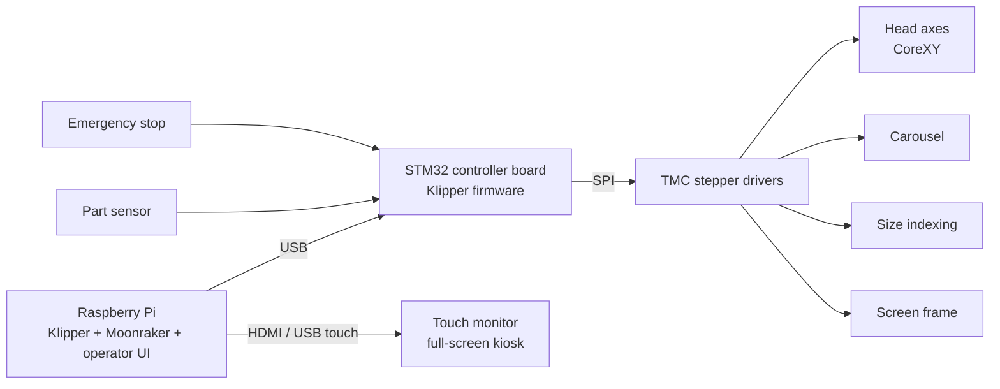

# Control System for an Automatic Screen Printing Machine

[Español](README.es.md) · **English**

Control software and electronics for an industrial automatic screen printing machine: a multi-axis CoreXY print head, an indexing carousel and a touchscreen operator interface, all driven by a single Raspberry Pi running **Klipper**.

This was professional work for an industrial equipment manufacturer. The source code is proprietary and is not published here; this page describes the architecture and the engineering problems solved.

## Demo

https://github.com/user-attachments/assets/54c06bf1-2015-4d0e-a3f7-c0d32aad4c07

## What I built

- **Motion control** on Klipper for a CoreXY print head plus independent axes for the carousel, size indexing and screen frame, using stepper drivers over SPI.
- **Sensorless homing** (TMC StallGuard) on several axes, calibrated per axis and per homing speed.
- **The complete print cycle as Klipper macros** (G-code + Jinja2): flood stroke, coordinated lowering, print stroke, raising and carousel advance, with part detection to skip empty stations.
- **A custom touchscreen interface** for the operator: single-page HTML/JavaScript talking to Moonraker over WebSocket (JSON-RPC), bilingual, running as a full-screen kiosk.
- **Safety logic in software**: homing required before any cycle, a guarded manual mode, and an emergency stop that shuts the firmware down immediately.
- **Automated macro validation**: a Python harness that renders every macro with Jinja2 the way Klipper does, so errors are caught before deploying to the machine.

## Architecture

## Engineering notes

Problems I had to solve along the way, and what they taught me:

- **StallGuard calibration depends on speed.** A stall threshold that homes reliably at one speed fails at another, so each axis is calibrated by bisection at its real homing speed and acceleration, and the homing macros pin those values explicitly.
- **Asynchronous sensors inside Klipper.** `gcode_button` events are queued until the running macro finishes. The carousel loop is therefore a two-step cycle, one step to move and one to read the sensor flag, so detections are never lost.
- **Motion profile limits.** On short moves the velocity profile is triangular and the commanded speed is never reached; peak speed is bounded by √(acceleration × distance). Acceleration is raised gradually and checked against homing repeatability to detect lost steps.
- **Configuration load order.** Virtual endstop pins exposed by the TMC drivers must be registered before the stepper that uses them, which dictates the section order in the config.
- **Safe state after releasing the motors.** Motor-release commands are intercepted so that any release aborts the running cycle and invalidates every home, forcing a new homing before production resumes.
- **One source of truth.** Manual and automatic modes read the same saved parameters, so a settings change applies to both and they can never behave differently.
- **Testing without the machine.** Rendering each macro in isolation with a mocked printer state catches syntax errors and inverted motions before they reach hardware, though it does not replace testing on the real machine.

## Tech stack

Klipper · Moonraker · Raspberry Pi OS · STM32 · TMC stepper drivers · G-code / Jinja2 macros · HTML / CSS / JavaScript · WebSocket JSON-RPC · Python · systemd · nginx · Git

## License

© 2026 Erwin. All rights reserved. This page is published as a portfolio sample; no use, copying or redistribution of its content is authorized.
